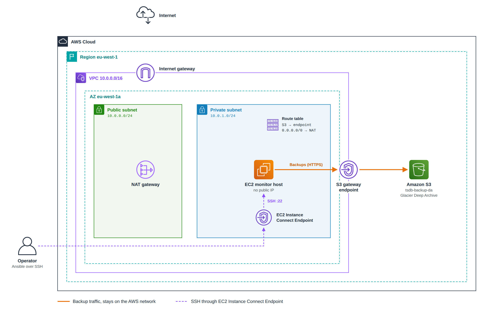
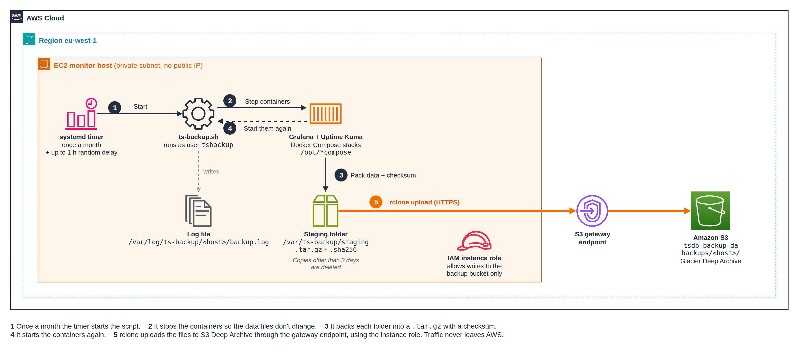

# Docker Compose Backups to S3 Glacier Deep Archive

A personal project for backing up self-hosted Docker Compose apps to cheap, long-term storage on AWS.

The example builds a small, private setup from scratch: one EC2 instance in a private subnet runs **Grafana** and **Uptime Kuma** with Docker Compose. Once a month, a systemd timer stops the stacks, packs their data folders, starts them again and uploads the archives to **S3 Glacier Deep Archive**. Nothing is exposed to the internet: the instance has no public IP, you reach it over SSH through an EC2 Instance Connect Endpoint, and backups travel to S3 over a VPC gateway endpoint.

- **Terraform** provisions the network, the instance, the bucket and the IAM role.
- **cloud-init** installs Docker and starts the example Compose stacks.
- **Ansible** installs the backup script, rclone and the systemd timer.

## Repository layout

```text
.
├── terraform-infra/              # VPC, EC2 instance, S3 bucket, IAM role
│   └── modules/
│       ├── vpc/                  # private + public subnet, NAT, S3 endpoint, Instance Connect Endpoint
│       ├── ec2/                  # instance, key pair, instance role, cloud-init
│       │   ├── compose/grafana/compose.yaml
│       │   ├── compose/kuma/compose.yaml
│       │   └── scripts/install-docker.sh
│       └── s3/                   # Deep Archive bucket, lifecycle rules, TLS-only policy
├── monitoring_backup.yaml        # Ansible playbook
├── backup_monitoring_data/       # Ansible role: backup script, rclone, systemd timer
├── backup_user/                  # Ansible role: service user that runs the backups
├── inventory.ini.example
├── instance_role.json            # IAM policy for backing up an instance you already run
├── backup-flow.png / .drawio     # backup flow diagram
└── architecture.png              # network diagram
```

## Quick start

You need an AWS account, the AWS CLI v2, Terraform and Ansible on your machine.

```bash
# 1. Create the SSH key that Terraform registers as the EC2 key pair
ssh-keygen -t rsa -b 4096 -m PEM -N "" -f terraform-infra/modules/ec2/mon_backup.pem

# 2. Create the VPC, instance and bucket
terraform -chdir=terraform-infra init
terraform -chdir=terraform-infra apply

# 3. Generate the Ansible inventory from the Terraform outputs
terraform -chdir=terraform-infra output -raw ansible_inventory > inventory.ini

# 4. Install the backup job on the instance
ansible-playbook -i inventory.ini monitoring_backup.yaml
```

Give cloud-init a few minutes after `terraform apply` to install Docker and start the containers before you run the playbook. Each step is described in more detail below.

> **Cost:** the NAT gateway is billed by the hour, even when idle. Tear the setup down when you are done testing (see [How to tear down the setup](#how-to-tear-down-the-setup)).

## Example: Docker Compose on a private instance



The instance runs Ubuntu 24.04 in a private subnet with no public IP. At first boot, cloud-init installs Docker Engine and starts one Compose stack per app. Each stack lives in its own folder under `/opt`, and its data is bind-mounted into that same folder:

```text
/opt/
├── grafanacompose/
│   ├── compose.yaml
│   └── grafana-data/          # Grafana dashboards, users, SQLite DB
└── kumacompose/
    ├── compose.yaml
    └── uptimekuma-data/       # Uptime Kuma monitors and history
```

`/opt/grafanacompose/compose.yaml`:

```yaml
services:
  grafana:
    image: grafana/grafana:latest
    container_name: grafana
    restart: unless-stopped
    ports:
      - "3000:3000"
    volumes:
      - ./grafana-data:/var/lib/grafana
```

`/opt/kumacompose/compose.yaml`:

```yaml
services:
  uptime-kuma:
    image: louislam/uptime-kuma:2
    container_name: uptime-kuma
    restart: unless-stopped
    ports:
      - "3001:3001"
    volumes:
      - ./uptimekuma-data:/app/data
```

This layout is what makes the backup simple: one folder holds both the Compose file and all of the app's state, so a single `.tar.gz` of the folder is a complete, restorable copy of the app.

### Open the apps in your browser

The security group only allows SSH from the Instance Connect Endpoint, so ports 3000 and 3001 are not reachable directly. Forward them over an SSH tunnel:

```bash
ssh -i terraform-infra/modules/ec2/mon_backup.pem \
  -o ProxyCommand="aws ec2-instance-connect open-tunnel --instance-id %h --region eu-west-1" \
  -L 3000:localhost:3000 -L 3001:localhost:3001 \
  ubuntu@<INSTANCE_ID>
```

Then open <http://localhost:3000> for Grafana and <http://localhost:3001> for Uptime Kuma. `terraform -chdir=terraform-infra output ssh_command` prints the plain SSH command for your instance.

### Back up your own stacks

To back up other apps, follow the same pattern and register them in [`backup_monitoring_data/files/backup.conf`](backup_monitoring_data/files/backup.conf):

```bash
BACKUP_SOURCES=(
    "/opt/kumacompose"
    "/opt/grafanacompose"
    "/opt/myappcompose"          # new
)

declare -A DOCKER_COMPOSE_MAP=(
    ["/opt/kumacompose"]="/opt/kumacompose"
    ["/opt/grafanacompose"]="/opt/grafanacompose"
    ["/opt/myappcompose"]="/opt/myappcompose"   # new: folder holding the compose file
)
```

- `BACKUP_SOURCES` lists the folders to archive.
- `DOCKER_COMPOSE_MAP` tells the script which Compose project to stop while a folder is archived. Leave a source out of the map if it doesn't need to be stopped.
- Use bind mounts (`./data:/path`) inside the stack folder. Data in named Docker volumes lives under `/var/lib/docker/volumes` and is **not** part of the archive.

Run the playbook again to deploy the changed config.

## How the backup works



1. **Once a month**, a systemd timer starts `ts-backup.sh`, with a random delay of up to 1 hour.
2. The script **stops the Grafana and Uptime Kuma containers**, so their data files don't change while they're copied.
3. It **packs each folder** (`/opt/grafanacompose`, `/opt/kumacompose`) into a `.tar.gz` file in the staging folder and writes a `.sha256` checksum next to it.
4. It **starts the containers again**. They're only down while the files are packed.
5. **rclone uploads** the files to the `tsdb-backup-da` bucket under `backups/<host>/`, in the Glacier Deep Archive storage class. The upload goes through the S3 gateway endpoint, so it never leaves the AWS network. The instance role gives the access, so the host stores no AWS keys.

Every run writes to `/var/log/ts-backup/<host>/backup.log`. Local copies older than 3 days are deleted from the staging folder.

To run a backup right away instead of waiting for the timer:

```bash
sudo systemctl start ts-backup.service
sudo tail -f /var/log/ts-backup/$(hostname -f)/backup.log
```

To edit the diagram, open [`backup-flow.drawio`](backup-flow.drawio) in [draw.io](https://app.diagrams.net) and export it again as `backup-flow.png`.

## What Terraform provisions

- **1 VPC** – a public subnet that only holds a NAT gateway, and a private subnet for the instance. The private subnet reaches the internet through the NAT gateway (for apt and Docker images) and reaches S3 through a gateway endpoint. An EC2 Instance Connect Endpoint lets you SSH in without a public IP or bastion.
- **1 EC2 instance** – a `t3.micro` running Ubuntu 24.04 in the private subnet, with no public IP. cloud-init installs Docker Engine and starts the Grafana and Uptime Kuma stacks.
- **1 S3 bucket** – `tsdb-backup-da`, which stores the backups in the **S3 Glacier Deep Archive** storage class. It blocks public access, encrypts objects at rest and only accepts TLS connections.
- **Instance role** – grants the instance least-privilege access to the backup bucket only.

### Using an instance you already have

If you'd rather back up a server you already run instead of the example instance, skip the EC2 module and attach the IAM policy in [`instance_role.json`](instance_role.json) to that instance's role (instance profile), or to a new role that you then attach to it. The policy allows listing the `tsdb-backup-da` bucket and reading, writing and deleting objects in it. Then add the host to your inventory and run the playbook.

### Why a VPC endpoint for S3

The instance sits in a private subnet. Without an endpoint, every backup upload to S3 would go out through the NAT gateway. The S3 gateway endpoint adds a route to the private route table, so S3 traffic goes straight from the VPC to S3 instead. This is a good approach because:

- **Lower cost** – NAT gateways charge per GB processed. Gateway endpoints for S3 are free, so large monthly backup uploads add no data-processing charges.
- **Traffic stays on the AWS network** – backups never cross the public internet, and the instance still needs no public IP.
- **No dependency on the NAT gateway** – backups keep working even if the NAT gateway is down or removed later.
- **Tighter access control** – an endpoint policy, or a bucket policy with `aws:SourceVpce`, can limit the bucket to traffic from this VPC only.

The endpoint only covers buckets in the same region as the VPC. Both `s3_region` and `ec2_region` default to `eu-west-1`. If you set them to different regions, uploads go back through the NAT gateway. A gateway endpoint works through route tables and has no security group of its own, so the instance's outbound security group rule is what controls this traffic.

### SSH key

Before you run `terraform apply`, put a `.pem` private key at `terraform-infra/modules/ec2/mon_backup.pem`. Terraform reads this file, derives the public key from it and registers it as the EC2 key pair. If the file is missing, `terraform plan` and `terraform apply` fail. Ansible and the `ssh_command` output use the same key to connect to the instance.

If you don't have a key yet, generate one:

```bash
ssh-keygen -t rsa -b 4096 -m PEM -N "" -f terraform-infra/modules/ec2/mon_backup.pem
```

The key is never committed, because `*.pem` is in `.gitignore`.

## What the Ansible playbook configures

- Creates the `tsbackup` service user, which runs the backups and is a member of the `docker` group so it can stop and start the stacks.
- Installs `rclone` from the apt package manager and checks that it can reach the bucket.
- Creates the staging directory `/var/ts-backup/staging/`, where backups are kept before they are transferred to S3.
- Creates the log directory. Logs from the systemd service are written to `/var/log/ts-backup/<hostname>/backup.log`.
- Creates a systemd service that runs the backup bash script.
- Creates a systemd timer that triggers the service once a month, with a random delay of up to 1 hour.

### Inventory

`inventory.ini` is not committed, because it holds the instance ID and a local path to the SSH key. Either generate it from the Terraform outputs:

```bash
terraform -chdir=terraform-infra output -raw ansible_inventory > inventory.ini
```

or create it from the example:

```bash
cp inventory.ini.example inventory.ini
```

and replace `<INSTANCE_ID>` with the instance ID and set `ansible_ssh_private_key_file` to the absolute path of the key. The instance has no public IP, so SSH runs through the EC2 Instance Connect Endpoint (`aws ec2-instance-connect open-tunnel`). This needs the AWS CLI v2 on your machine and the `ec2-instance-connect:OpenTunnel` permission.

Run the playbook with:

```bash
ansible-playbook -i inventory.ini monitoring_backup.yaml
```

The playbook runs on `hosts: all`, so every host in the inventory gets configured. To back up more machines, add them as extra lines under `[poc]` or under groups of your own.

## How to restore the backup

Run these steps on the instance. They only use `rclone`, which the playbook already installs and configures. rclone gets its access from the instance role (`env_auth = true` in `rclone.conf`), so you don't need any AWS keys. The config file is readable only by the `tsbackup` user, so the commands run rclone with `sudo`.

```bash
RCLONE="sudo rclone --config /etc/rclone/rclone.conf"
REMOTE=s3-deep-archive:tsdb-backup-da
HOST=$(hostname -f)
FILE=<host>_kumacompose_<TIMESTAMP>.tar.gz    # set from step 1
```

### 1. List the backups

```bash
$RCLONE lsl $REMOTE/backups/$HOST/
```

Each archive has a `.sha256` file next to it with the same name.

### 2. Restore from Deep Archive

The backup script uploads every file straight to DEEP_ARCHIVE. Objects in DEEP_ARCHIVE can't be downloaded directly. You have to ask S3 to make a temporary copy readable first. This command restores the archive and its `.sha256` file:

```bash
$RCLONE backend restore $REMOTE/backups/$HOST/ --include "/$FILE*" \
  -o priority=Standard -o lifetime=7
```

- `lifetime` is how many days the restored copy stays readable before S3 removes it again. The original object stays in DEEP_ARCHIVE.
- `priority` sets the speed. `Standard` finishes within 12 hours. `Bulk` is cheaper and finishes within 48 hours. Deep Archive does not support `Expedited`.
- Add `--dry-run` first if you want to see which files the filter matches.

rclone prints a JSON list with one entry per file. `"Status": "OK"` means S3 accepted the restore request. Any other status is the error message from S3.

> **Note:** a restore needs the `s3:RestoreObject` permission. Neither `instance_role.json` nor the Terraform instance role grants it right now, so add it to the policy before you run this step.

### 3. Wait for the restore

The rclone version from apt (1.60 on Ubuntu 24.04) can't show restore progress. To check whether the files are ready, run the download in step 4. If the restore isn't finished, rclone stops with an error that says the object is in DEEP_ARCHIVE (or `InvalidObjectState`). Wait and try again later.

On rclone 1.64 or newer, you can check the progress directly:

```bash
$RCLONE backend restore-status $REMOTE/backups/$HOST/$FILE
```

### 4. Download the backup and its checksum

```bash
sudo mkdir -p /var/ts-backup/restore
$RCLONE copy $REMOTE/backups/$HOST/ /var/ts-backup/restore/ --include "/$FILE*"
cd /var/ts-backup/restore
```

### 5. Verify the checksum

```bash
echo "$(cut -d' ' -f1 $FILE.sha256)  $FILE" | sha256sum -c -
```

### 6. Restore the data

```bash
cd /opt/kumacompose && sudo docker compose down
sudo mv /opt/kumacompose /opt/kumacompose.pre-restore-$(date +%F)
sudo tar -xzf /var/ts-backup/restore/$FILE -C /opt
cd /opt/kumacompose && sudo docker compose up -d
```

Repeat with the `grafanacompose` file and `/opt/grafanacompose` if you need Grafana back too.

## How to tear down the setup

`terraform destroy` fails if the bucket isn't empty, so empty it first. Run this from your machine, not the EC2 instance:

```bash
aws s3 rm s3://tsdb-backup-da --recursive --region eu-west-1
terraform -chdir=terraform-infra destroy
```

> **Warning:** this permanently deletes all backups. Deep Archive bills each object for at least 180 days, even if you delete it earlier.
